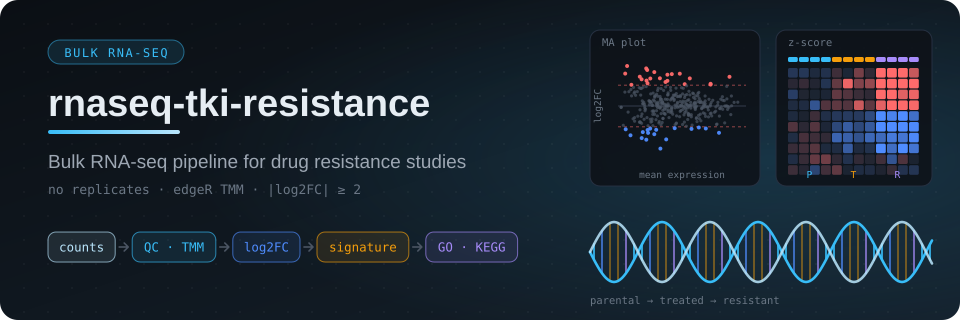
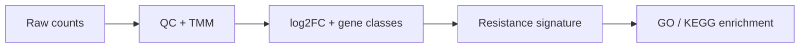

<div align="center">



# Bulk RNA-seq — TKI Resistance Transcriptomics in NSCLC


[Objective](#objective) · [Pipeline](#pipeline) · [Reproducibility](#reproducibility) · [Repository structure](#repository-structure) · [References](#references)

</div>

---

## Objective

When a lung cancer cell becomes resistant to a tyrosine kinase inhibitor, does it switch on a new transcriptional program, or was that program already running before the drug arrived?

Each model is profiled in three states: the parental population, the parental population under drug, and the resistant population selected from it. The models are NSCLC lines and patient-derived cells driven by EGFR, ALK, MET or RET.

One constraint shapes everything. Every resistant population comes from a single parental culture and was sequenced once, so there is no variance to estimate. Fold changes can be computed but not tested, which rules out DESeq2 and edgeR GLM. Following the edgeR User's Guide (section "What to do if you have no replicates") and published replicate-free approaches (Maza 2016), the pipeline normalizes with TMM and calls changes with a conservative |log2FC| ≥ 2 instead of p-values. The output is descriptive: it nominates candidates for follow-up.

---

## Pipeline



| Step | Script | Output |
|------|--------|--------|
| 01 — QC | `rna_01.1_qc.R` | TMM matrix · PCA · sample distances · top-variable heatmap |
| 02 — LFC | `rna_02.1_lfc.R` | log2 fold changes · gene classification |
| 03 — Key genes | `rna_03.1_key_genes.R` | Resistance signature (full and conservative) · heatmaps |
| 04 — Pathways | `rna_04.1_pathways.R` | GO BP and KEGG over-representation · GSEA |

Scripts in `scripts/simple/` run one model at a time: set the CONFIG block at the top and source the script. Each step also renders an HTML report from its Rmd.

The same steps cover three experimental designs:

| Design | Comparison | Scripts |
|--------|------------|---------|
| Two groups | Parental vs resistant | `scripts/simple/` 01 → 04 |
| Treated parental | Parental, parental under drug and resistant, one or more drugs | `rna_01.1`, then `scripts/specific/RET/` 02b → 04b |
| Per cell line | Several cell lines and drugs, plus fusion calls | `scripts/specific/ALK/` |

The conservative signature drops genes with almost no parental expression. Fold changes from a near-zero baseline are mostly noise, and this version is the one to use downstream.

---

## Reproducibility

**R** 4.5 · paths are built with [`here`](https://here.r-lib.org/), so any script runs from any folder inside the repository. Start R from inside the repository (or open the folder as a project): `here` fixes the root the first time it is loaded, and a later `setwd()` does not change it.

```r
# Bioconductor
BiocManager::install(c("edgeR", "clusterProfiler", "org.Hs.eg.db", "enrichplot",
                       "ComplexHeatmap", "STRINGdb", "AnnotationDbi"))
# CRAN
install.packages(c("here", "dplyr", "tidyr", "tibble", "ggplot2", "ggrepel", "pheatmap",
                   "circlize", "patchwork", "RColorBrewer", "readxl", "VennDiagram",
                   "rmarkdown", "knitr", "kableExtra"))
```

```r
# Set the CONFIG block (dataset, cell line, drug, receptor), then:
source(here::here("scripts/simple/rna_01.1_qc.R"))
```

Count matrices and metadata come from patient-derived models and are not versioned (see `.gitignore`). Shared palettes and reference gene sets live in `config/`.
**Requirements and status.** KEGG enrichment queries the KEGG web service, so it needs an internet connection. `pandoc` is optional: without it the scripts skip the HTML reports and still write the tables, figures and Markdown reports. `STRINGdb` is optional too. The scripts were run end to end on simulated data in November 2026 (MET, EGFR, RET and ALK). Two curated checks need real data: `MET_01_summary_figures.R` and `RET_09_lfc_heatmaps.R` require specific GO terms to be significant, which simulated data may not satisfy.

---

## Repository structure

```
rnaseq-tki-resistance/
├── config/                 # colors.R · gene_lists.R
├── data/                   # counts, metadata, fusion calls — not versioned
├── scripts/
│   ├── simple/             # generic pipeline 01–04 + Rmd reports
│   ├── specific/
│   │   ├── ALK/            # per-line pipeline (one folder per cell line) + combined figures
│   │   ├── EGFR/
│   │   ├── MET/
│   │   └── RET/            # treated-parental design, fusions, combined figures
│   └── utils/         # helpers shared across targets
└── results/                # selected figures per target
```

---

## References

- Robinson MD, McCarthy DJ, Smyth GK (2010). edgeR. *Bioinformatics* 26(1):139–140. [doi:10.1093/bioinformatics/btp616](https://doi.org/10.1093/bioinformatics/btp616)
- Robinson MD, Oshlack A (2010). TMM normalization. *Genome Biology* 11:R25. [doi:10.1186/gb-2010-11-3-r25](https://doi.org/10.1186/gb-2010-11-3-r25)
- edgeR User's Guide, section "What to do if you have no replicates". [Bioconductor](https://bioconductor.org/packages/release/bioc/vignettes/edgeR/inst/doc/edgeRUsersGuide.pdf)
- Maza E (2016). TMM vs RLE vs MRN for replicate-free RNA-seq. *Front Genetics* 7:164. [doi:10.3389/fgene.2016.00164](https://doi.org/10.3389/fgene.2016.00164)
- Yu G et al. (2012). clusterProfiler. *OMICS* 16(5):284–287. [doi:10.1089/omi.2011.0118](https://doi.org/10.1089/omi.2011.0118)
